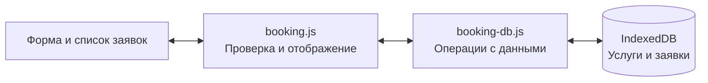

# Документация проекта «Автосервис»

## Назначение

Сайт знакомит посетителя с услугами автосервиса. Учебный раздел «Запись» показывает работу программы с базой данных. Пользователь выбирает услугу, указывает автомобиль и время визита, затем просматривает или удаляет сохранённую заявку.

## Архитектура

| Файл | Назначение |
| --- | --- |
| [`booking.html`](../booking.html) | Форма записи и список заявок |
| [`css/booking.css`](../css/booking.css) | Оформление раздела записи |
| [`js/booking.js`](../js/booking.js) | Проверка полей и обновление страницы |
| [`js/booking-db.js`](../js/booking-db.js) | Создание базы, чтение, добавление и удаление записей |

GitHub Pages раздаёт статические файлы. Программа выполняется в браузере и сохраняет заявки в его локальной базе. В другом профиле браузера список будет отдельным. При очистке данных сайта заявки удалятся. [Спецификация IndexedDB](https://www.w3.org/TR/IndexedDB/)

## Структура базы данных

База `avtoservis-booking` версии 1 создаётся при первом открытии раздела «Запись». Она содержит два хранилища.

| Хранилище | Поля |
| --- | --- |
| `services` | `id` — строковый первичный ключ, `name` — название услуги. Шесть услуг добавляются при создании базы. |
| `appointments` | `id` — числовой ключ с автоинкрементом, `serviceId` — ключ услуги, `customerName` — имя, `vehicle` — автомобиль, `date` — дата в формате `ГГГГ-ММ-ДД`, `time` — время в формате `ЧЧ:ММ`, `note` — необязательный комментарий. |

Одной услуге могут соответствовать несколько заявок. При сохранении программа проверяет `serviceId` по загруженному справочнику. Уникальный индекс `bySlot` по полям `date` и `time` запрещает повторную запись на то же время в пределах одной базы. Чтение через этот индекс выводит заявки по дате и времени.

## Сохранение заявки

1. Браузер проверяет заполнение обязательных полей.
2. Программа проверяет услугу, имя, автомобиль и время визита. Время должно быть позже текущего по часам устройства.
3. IndexedDB добавляет запись в транзакции и проверяет уникальность времени. При совпадении форма сохраняет введённые данные и предлагает выбрать другое время.
4. После завершения транзакции программа показывает номер заявки и обновляет список.

## Проверка проекта

Локальная проверка выполнена в Microsoft Edge.

| Действие | Наблюдаемый результат |
| --- | --- |
| Открыть «Запись» из главного меню | Форма загружается, в справочнике шесть услуг |
| Сохранить пустую форму или выбрать прошедшее время | Заявка не появляется |
| Создать заявку и обновить страницу | Заявка остаётся в списке |
| Создать заявку на то же время из другой вкладки | База сохраняет только одну заявку на выбранное время |
| Удалить заявку и обновить страницу | Удалённая заявка исчезает, время снова доступно |
| Открыть раздел в отдельном профиле браузера | Появляется отдельный список заявок |

## Демонстрация на защите

1. Откройте опубликованный сайт и перейдите в «Запись». [Сайт проекта](https://ovodukolga-spec.github.io/avtoservis/)
2. Выберите «Замена масла». Введите «Тестовый клиент», «Учебный автомобиль» и любую будущую дату.
3. Сохраните заявку, покажите её номер и обновите страницу. Запись останется в списке.
4. Откройте инструменты разработчика Edge. На вкладке **Application** разверните **IndexedDB** и покажите хранилища `services` и `appointments`.
5. Попробуйте повторить запись на то же время, затем удалите тестовую заявку.
6. Покажите исходную версию, добавление базы и документацию в истории Git. [Коммиты проекта](https://github.com/ovodukolga-spec/avtoservis/commits/main/)
